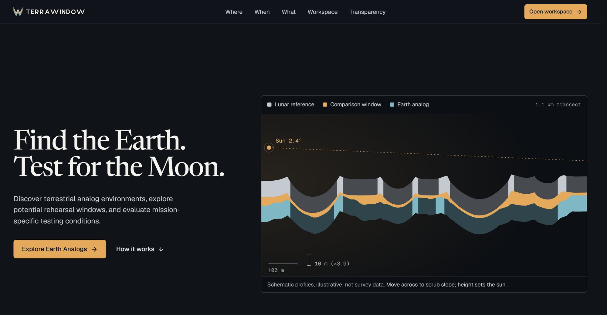
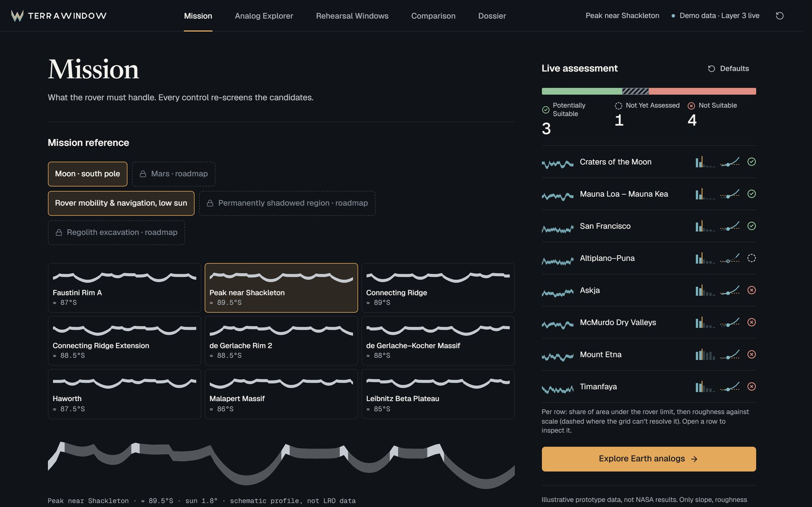
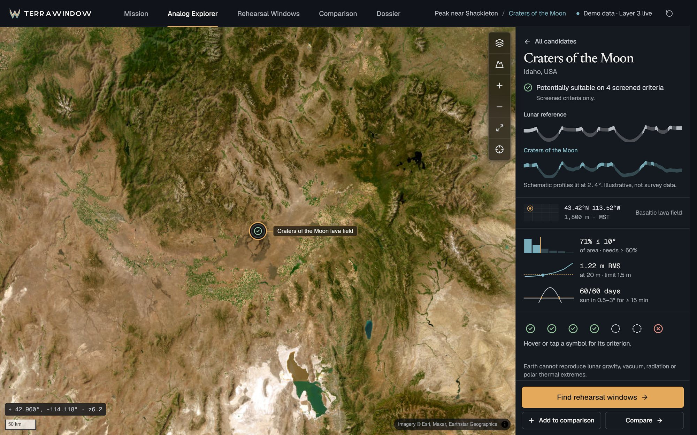
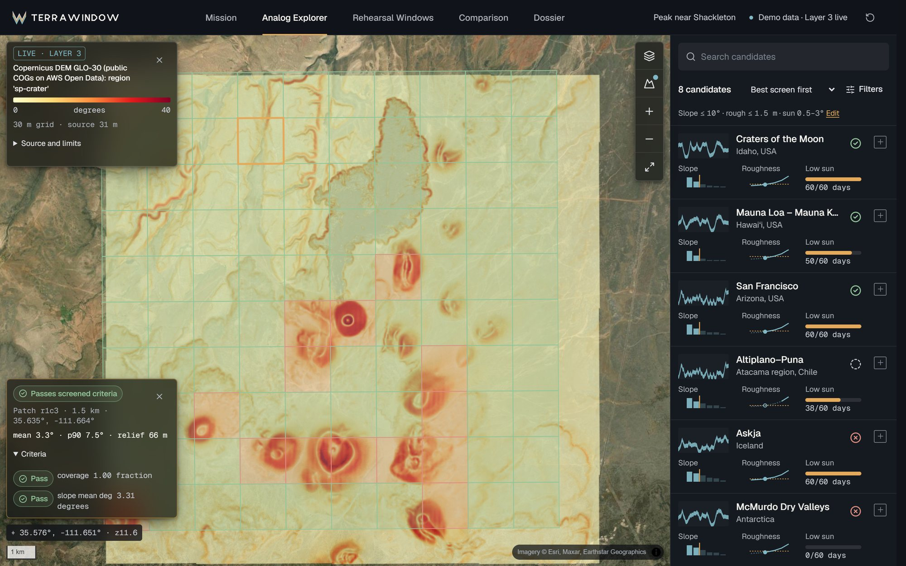
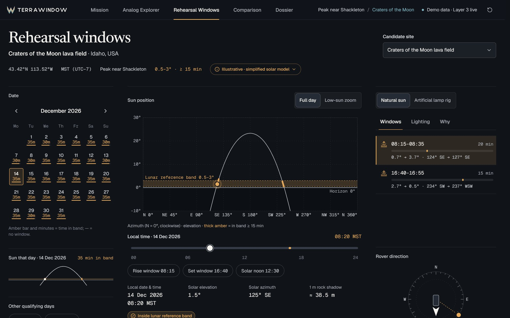
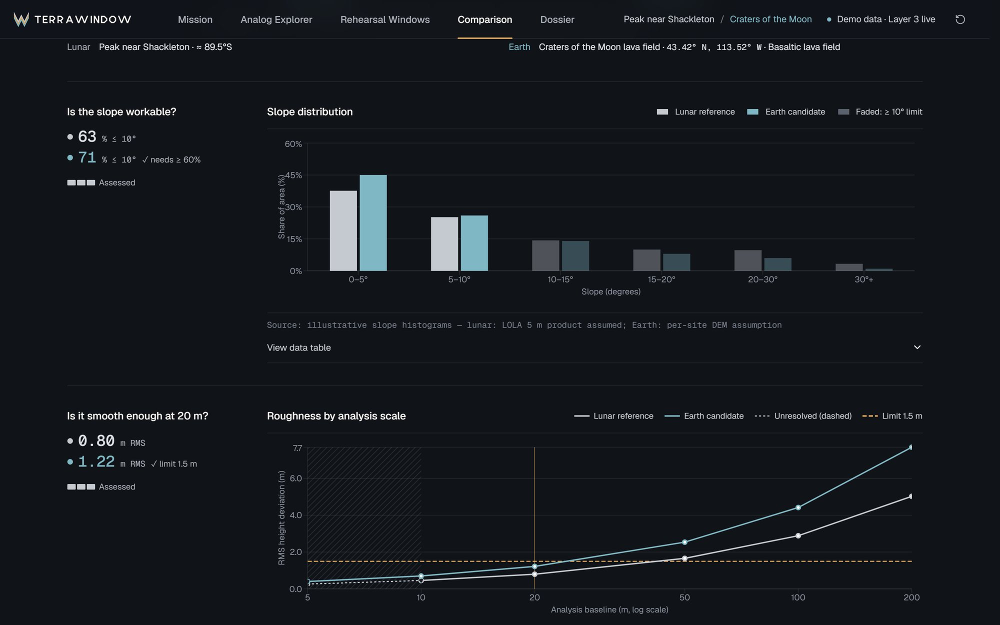
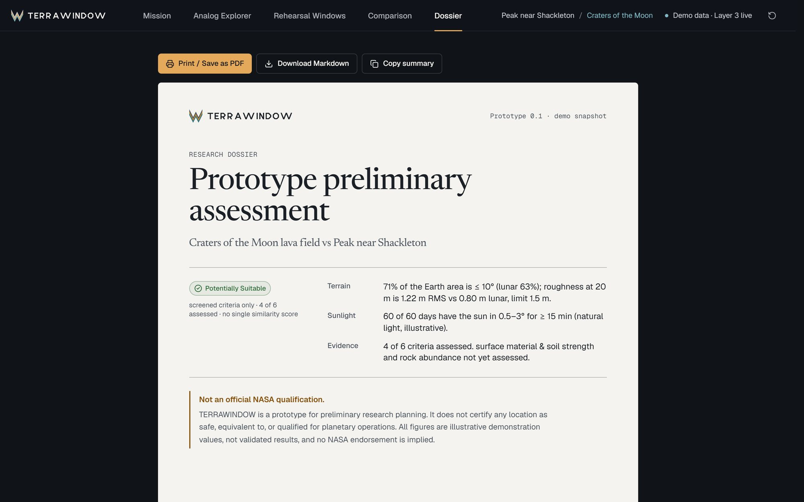
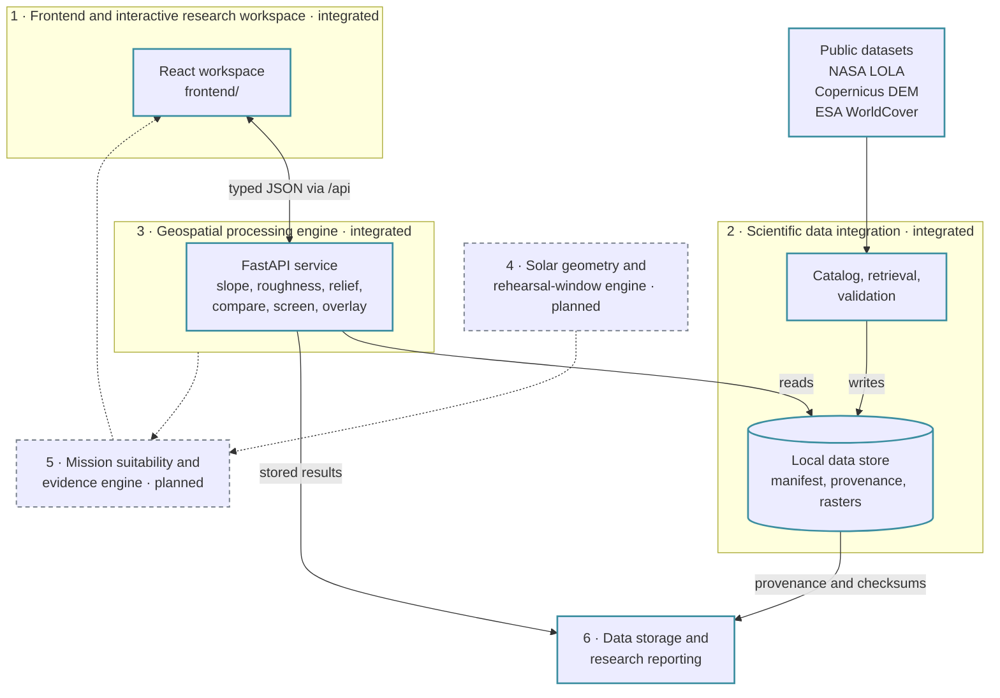

<p align="center">
  <picture>
    <source media="(prefers-color-scheme: dark)" srcset="frontend/public/brand/terrawindow-lockup-dark.svg">
    
  </picture>
</p>

<h3 align="center">Find the Earth. Test for the Moon.</h3>

<p align="center">
  Mission-specific Earth analog discovery and rehearsal planning<br>
  <sub>NASA Space Apps Challenge 2026 · Research prototype</sub>
</p>

<p align="center">
  
</p>

> TERRAWINDOW is an independent entry to the NASA Space Apps Challenge. It is not affiliated with or endorsed by NASA, it does not certify any site, and it produces no single Moon–Earth similarity score.

## Overview

A rover that will drive on the lunar south pole needs somewhere on Earth to rehearse. Finding that place is harder than looking for terrain that resembles the Moon: slope and roughness only compare where the elevation data can resolve them, the sun sits a few degrees above the horizon there, and gravity, vacuum, radiation and cold cannot be reproduced on Earth at all.

TERRAWINDOW helps a researcher work through that question in the open. It discovers candidate Earth terrain against a stated lunar reference and mission limits, compares the two surfaces criterion by criterion at scales the data can support, and explores when low-angle lighting on Earth resembles the lunar case. Every verdict stays tied to its evidence: what was measured, at what resolution, from which dataset, and what is still missing.

The working scope is **lunar south-polar rover mobility and navigation under low-angle illumination**. Mars is a locked roadmap item.

## Product showcase

<table>
  <tr>
    <td width="50%"><br><sub><b>Mission Workspace.</b> Set the lunar reference and rover limits; candidates re-screen as you change them. <i>Illustrative data.</i></sub></td>
    <td width="50%"><br><sub><b>Analog Explorer.</b> A satellite map with a visual candidate browser and a per-site inspector. <i>Example sites are illustrative.</i></sub></td>
  </tr>
  <tr>
    <td width="50%"><br><sub><b>Live terrain.</b> Slope overlay and candidate-patch screening computed by the geoprocessing service from a stored Copernicus DEM. <i>Measured, labelled live.</i></sub></td>
    <td width="50%"><br><sub><b>Rehearsal Windows.</b> Calendar, solar track and qualifying windows as one instrument. <i>Simplified solar model; demonstration.</i></sub></td>
  </tr>
  <tr>
    <td width="50%"><br><sub><b>Scientific Comparison.</b> Slope and roughness against the rover limit, with resolution shown. <i>Illustrative; a separate panel shows measured evidence.</i></sub></td>
    <td width="50%"><br><sub><b>Research Dossier.</b> A printable preliminary assessment with provenance and an explicit disclaimer. <i>Demonstration content.</i></sub></td>
  </tr>
</table>

## Core capabilities

| Capability | What it does | Status |
|---|---|---|
| **Mission Workspace** | Defines the lunar reference, rover slope and roughness limits, and the lighting band; re-screens candidates | Demonstration data |
| **Earth Analog Explorer** | Satellite map, candidate browser, site inspector, comparison basket | Example sites: demonstration. **Live terrain: operational** (Layers 2–3) |
| **Terrain analysis** | Slope, roughness, relief and profiles at stated grid scales; overlays; candidate-patch screening | **Operational** (Layer 3) |
| **Scientific comparison** | Lunar reference against an Earth candidate, criterion by criterion, with no combined score | Demonstration sections. **Measured evidence panel: operational** (Layers 2–3) |
| **Rehearsal-window exploration** | Calendar and solar track of low-sun windows | Demonstration: simplified flat-horizon model, no terrain shadows (Layer 4 pending) |
| **Research dossier** | Printable preliminary assessment, Markdown export | Demonstration; states it contains no measured evidence |

An implemented interface is not the same as an operational scientific feature. Live content is labelled **LIVE · LAYER 3** and carries its dataset, citation, grid size and limitations. If the service is offline, a dataset is unavailable or a request fails, the interface says so and shows nothing in its place: demonstration values are never substituted for a missing result.

## Architecture



<sub>Solid outline: implemented. Dashed outline: planned, with no implementation in this repository.</sub>

| Layer | Responsibility | Status | Where |
|---|---|---|---|
| 1 | Frontend and interactive research workspace | Implemented and integrated. Several screens still use demonstration data | [`frontend/`](frontend) |
| 2 | Scientific data integration: catalog, retrieval, validation, provenance | Implemented and integrated | [`backend/data_integration`](backend/data_integration) |
| 3 | Geospatial processing engine and API | Implemented and integrated | [`backend/geoprocessing`](backend/geoprocessing), [API contract](docs/layer3-api-contract.md) |
| 4 | Solar geometry and rehearsal-window engine | Not started in this repository | none |
| 5 | Mission suitability and evidence engine | Not started in this repository | none |
| 6 | Data storage and research reporting | Implemented. Separate service; the frontend dossier is unchanged | [`backend/reporting`](backend/reporting) |

Layers 4 and 5 have no implementation in this repository. The frontend keeps their screens available as clearly labelled demonstrations. Layer 6 records dataset provenance, analysis runs, and dossiers; it does not replace the file store or the processing cache.

## Technology stack

Versions are taken from `frontend/package.json` and `backend/*/pyproject.toml`.

| Area | Technologies |
|---|---|
| Frontend | React 19, TypeScript 6, Vite 8, Tailwind CSS 4, Motion, MapLibre GL JS 6, Recharts 3, lucide-react |
| Typography | Geist, Geist Mono and Newsreader via Fontsource |
| Backend | Python 3.12+, FastAPI, Uvicorn, Pydantic 2, rasterio, NumPy, SciPy, pyproj, Pillow, psycopg, fpdf2 |
| Data | GeoTIFF and cloud-optimised GeoTIFF; a file-based store with a version-controlled reference manifest; PostgreSQL and PostGIS for the Layer 6 registry |
| Quality | Vitest, ESLint, pytest |

## Getting started

**Prerequisites:** Node.js 22.12 or newer (20.19 is enough to run and build the frontend, but `npm test` needs 22.12), Python 3.12 or newer, and Git.

```bash
git clone https://github.com/sinagdevv/Supernobai-NASA.git
cd Supernobai-NASA
```

**1. Backend environment** (one virtual environment for Layers 2 and 3)

```bash
cd backend
python -m venv .venv
.venv/Scripts/python -m pip install -e "geoprocessing[dev]" -e "data_integration[dev]"
```

On macOS and Linux use `.venv/bin/python` and `.venv/bin/terrawindow-data` in place of `.venv/Scripts/...`.

**2. Retrieve datasets.** Rasters are never committed. The NASA download is about 41 MB and can take several minutes.

```bash
.venv/Scripts/terrawindow-data fetch lola-5mpp-site01
.venv/Scripts/terrawindow-data region copernicus-glo30 sp-crater -111.72 35.51 -111.54 35.655
```

Check the result before using it. `check` lists each dataset as `available`, `missing`, `unreadable` or `not_validated`, with the command that fixes it, and exits 1 if any is unusable.

```bash
cd geoprocessing
../.venv/Scripts/python -m terrawindow_geo.cli check
```

**3. Run the service and the frontend**

```bash
# in backend/geoprocessing
../.venv/Scripts/python -m uvicorn terrawindow_geo.api.app:app --port 8000

# in a second terminal
cd frontend
npm ci
npm run dev
```

The frontend works without the service, on demonstration data. The dev and preview servers proxy `/api` to `http://localhost:8000`; set `VITE_TERRAWINDOW_API` to point elsewhere.

**Tests and build**

| Command | Where | What it runs |
|---|---|---|
| `python -m pytest` | `backend/geoprocessing`, `backend/data_integration`, `backend/reporting` | Backend suites (no network by default; Layer 6 Postgres tests need `TERRAWINDOW_DATABASE_URL`) |
| `npm test` | `frontend/` | Unit tests for the API boundary |
| `npm run lint` | `frontend/` | ESLint |
| `npm run build` | `frontend/` | Type-check, then a production build in `dist/` |
| `npm run preview` | `frontend/` | Serve the production build |

### How dataset setup stays reproducible

`backend/data/manifest.json` and the `*.provenance.json` files beside the rasters are the **version-controlled reference**: what each dataset is, where it came from, and its checksum. `terrawindow-data` writes what happens on your machine (validation result, timestamps) to `backend/data/local/`, which is not committed, and the service reads the two together. Setting up data therefore leaves `git status` clean.

Each setup is compared with the reference provenance (SHA-256, size and source URLs) and reports `matches` or `differs`. A difference is flagged, never silently overwritten; use `--update-reference` to change the reference on purpose. Set `TERRAWINDOW_DATA_DIR` to keep the whole store outside the repository. The service decides whether a dataset is usable from the file itself, so a fresh checkout reports missing rasters as setup required and never as ready.

## Data sources

| Dataset | Provider | Resolution | Licence | Role in TERRAWINDOW |
|---|---|---|---|---|
| [LOLA 5 m/pix south-pole site models](https://pgda.gsfc.nasa.gov/products/78) | NASA Planetary Geodesy Data Archive | 5 m | NASA data, public domain; cite the dataset paper | Lunar reference terrain. Ten sites are catalogued; Site01 (Connecting ridge) is used in the measured comparison |
| [Copernicus DEM GLO-30](https://dataspace.copernicus.eu/explore-data/data-collections/copernicus-contributing-missions/collections-description/COP-DEM) | European Space Agency, via AWS Open Data | 30 m | Free of charge, attribution required | Earth candidate terrain, cut into regions. It is a surface model: it includes vegetation and buildings |
| [ESA WorldCover 10 m 2021 v200](https://esa-worldcover.org) | European Space Agency | 10 m | CC BY 4.0 | Optional land-cover screen in the geoprocessing engine |

Citations:

- Barker, M. K., et al. (2021). Improved LOLA elevation maps for south pole landing sites: Error estimates and their impact on illumination conditions. *Planetary and Space Science*, 203, 105119. https://doi.org/10.1016/j.pss.2020.105119
- European Space Agency (2024). Copernicus Global Digital Elevation Model. Distributed by OpenTopography. https://doi.org/10.5069/G9028PQB
- Zanaga, D., et al. (2022). ESA WorldCover 10 m 2021 v200. https://doi.org/10.5281/zenodo.7254221

Basemaps: imagery © Esri, Maxar, Earthstar Geographics and the GIS User Community; topographic tiles © OpenTopoMap (CC-BY-SA), data © OpenStreetMap contributors; dark base © CARTO, data © OpenStreetMap contributors; relief tiles from Terrain Tiles (Mapzen / AWS Open Data).

Listing a data resource implies no endorsement by, or affiliation with, any agency. The terrain figures behind the demonstration screens are illustrative fixtures, not measurements from these datasets.

## Scientific limitations

- **Demonstration features.** The example sites and their statuses, the Mission Workspace, Rehearsal Windows and the Dossier run on illustrative data. The Rehearsal Windows use a simplified flat-horizon solar model in the browser, without terrain shadows. Mission criteria are screening assumptions, not mission requirements.
- **Earth is not the Moon.** Gravity, vacuum, radiation and polar thermal extremes cannot be reproduced on Earth. The interface lists them as *Earth cannot reproduce* and keeps them out of any overall category. Soil strength and rock abundance are not assessed from terrain data at all.
- **Resolution and uncertainty.** A 30 m Earth grid cannot resolve the terrain scales a 5 m lunar grid can. Comparisons are made only at scales both datasets support, and the service returns each dataset's limitations beside the numbers. Lunar heights include interpolated pixels. Copernicus GLO-30 is a surface model, not bare ground.
- **No universal score.** Each criterion is judged on its own as potentially suitable, not suitable or not yet assessed. A screening candidate is a shortlist entry for stated criteria, not a suitability verdict.
- **Map coverage.** The Explorer's live layers cover Earth datasets only, because its Web Mercator map cannot show the lunar south pole. Lunar data appears in the Comparison panel.
- **No endorsement or certification.** TERRAWINDOW is not an official NASA product, and its output is preliminary research planning, not qualification of any site for planetary operations.

## Roadmap

| Layer | Status |
|---|---|
| 1 · Frontend and interactive research workspace | Done |
| 2 · Scientific data integration | Done |
| 3 · Geospatial processing engine | Done |
| 4 · Solar geometry and rehearsal-window engine | Planned. Replaces the browser's simplified solar model and adds terrain horizon shadows |
| 5 · Mission suitability and evidence engine | Planned. Replaces the demonstration screening assumptions with mission-specific criteria |
| 6 · Data storage and research reporting | Done. Postgres registry, run checksums, and Markdown/PDF dossiers. The on-screen dossier is still demonstration data |
| Mars | Locked roadmap item |

## Repository layout

```
frontend/                       Layer 1: React workspace; frontend/src/lib/api is the only boundary to the backend
backend/data_integration/       Layer 2: catalog, retrieval, validation, provenance (terrawindow-data)
backend/geoprocessing/          Layer 3: geospatial engine and FastAPI service (terrawindow-geo)
backend/reporting/              Layer 6: run registry, candidate storage, integrity checks, dossiers (terrawindow-report)
backend/data/                   Version-controlled reference manifest and provenance; rasters and local state are ignored
docs/                           API contract and README media
```

Further reading: [Layer 3 API contract](docs/layer3-api-contract.md) · [Layer 3 README](backend/geoprocessing/README.md) · [Layer 2 README](backend/data_integration/README.md) · [Layer 6 README](backend/reporting/README.md)

## Contributors

Credits follow the repository's commit history.

- **[Gabriel John Solomon](https://github.com/Gabi-comm)** authored the Layer 3 geospatial engine and API and the Layer 2 data integration.
- **[sinagdev](https://github.com/sinagdevv)** authored the V4 frontend and its integration with Layers 1 to 3.

## License

No license file has been added to this repository yet.
