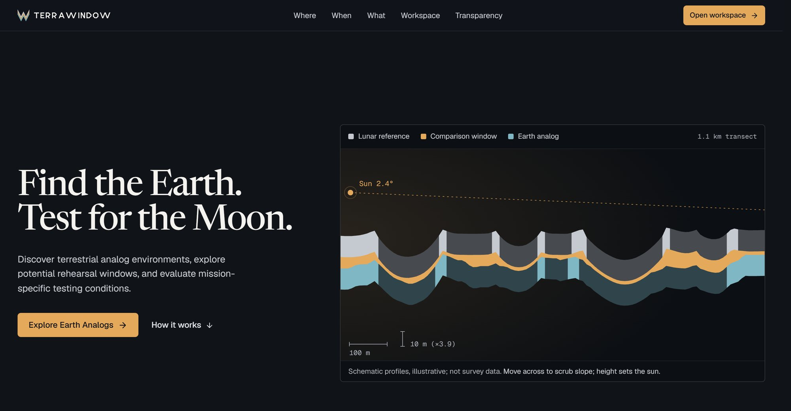
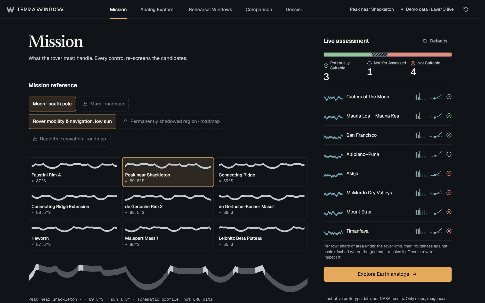
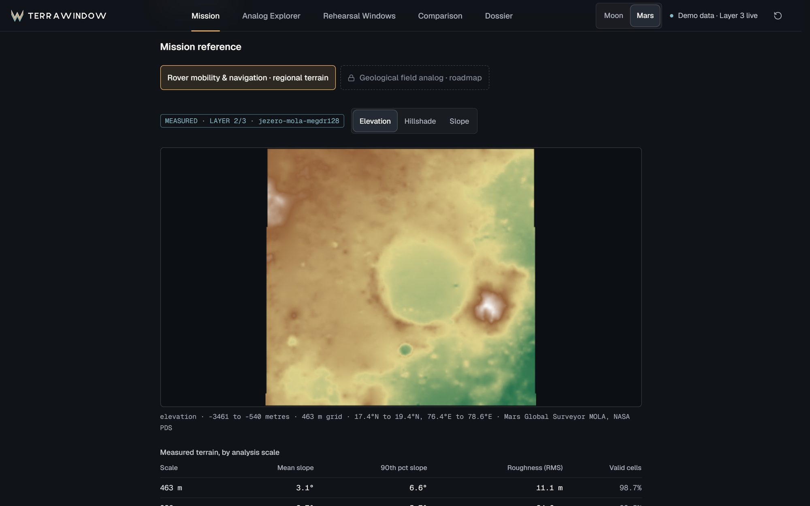
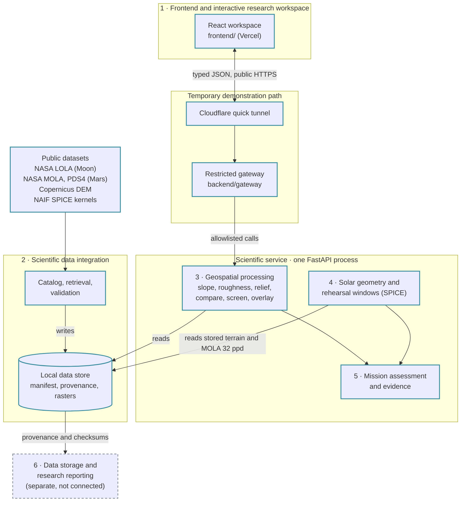

<p align="center">
  <picture>
    <source media="(prefers-color-scheme: dark)" srcset="frontend/public/brand/terrawindow-lockup-dark.svg">
    
  </picture>
</p>

<h3 align="center">Find the Earth. Test for the Moon.</h3>

<p align="center">
  Mission-specific Earth analog discovery for the Moon and Mars<br>
  <sub>NASA Space Apps Challenge 2026 · Research prototype</sub>
</p>

<p align="center">
  
</p>

> TERRAWINDOW is an independent entry to the NASA Space Apps Challenge. It is not affiliated with or endorsed by NASA, it does not certify any site, and it produces no single Moon–Earth similarity score.

## Overview

A rover that will drive on the lunar south pole needs somewhere on Earth to rehearse. Finding that place is harder than looking for terrain that resembles the Moon: slope and roughness only compare where the elevation data can resolve them, the sun sits a few degrees above the horizon there, and gravity, vacuum, radiation and cold cannot be reproduced on Earth at all.

TERRAWINDOW helps a researcher work through that question in the open. It discovers candidate Earth terrain against a stated lunar reference and mission limits, compares the two surfaces criterion by criterion at scales the data can support, and explores when low-angle lighting on Earth resembles the lunar case. Every verdict stays tied to its evidence: what was measured, at what resolution, from which dataset, and what is still missing.

TERRAWINDOW covers two planetary targets in one workspace, switched with the **Moon / Mars** control in the landing page and the workspace header.

- **Moon** is the full prototype scope: lunar south-polar rover mobility and navigation under low-angle illumination, with illustrative mission screens and measured terrain evidence from NASA LOLA data.
- **Mars** is a regional, data-backed experience: **terrain measured from NASA MOLA topography** (the Jezero region, 463 m pixels) compared with measured Earth terrain per criterion at one stated scale, **solar geometry computed with SPICE** for Mars, and a mission assessment that keeps Layer 4 values as unverified claims. It has no rover-scale terrain and no Mars-specific mission standards. See [Mars research support](#mars-research-support) and [Layers 4 and 5](#layers-4-and-5-solar-geometry-and-mission-assessment).

## Product showcase

<table>
  <tr>
    <td width="50%"><br><sub><b>Mission Workspace.</b> Set the lunar reference and rover limits; candidates re-screen as you change them. <i>Illustrative data.</i></sub></td>
    <td width="50%"><br><sub><b>Analog Explorer.</b> A satellite map with a visual candidate browser and a per-site inspector. <i>Example sites are illustrative.</i></sub></td>
  </tr>
  <tr>
    <td width="50%"><br><sub><b>Live terrain.</b> Slope overlay and candidate-patch screening computed by the geoprocessing service from a stored Copernicus DEM. <i>Measured, labelled live.</i></sub></td>
    <td width="50%"><br><sub><b>Rehearsal Windows.</b> Calendar, solar track and qualifying windows as one instrument. <i>Simplified solar model; demonstration.</i></sub></td>
  </tr>
  <tr>
    <td width="50%"><br><sub><b>Scientific Comparison.</b> Slope and roughness against the rover limit, with resolution shown. <i>Illustrative; a separate panel shows measured evidence.</i></sub></td>
    <td width="50%"><br><sub><b>Research Dossier.</b> A printable preliminary assessment with provenance and an explicit disclaimer. <i>Demonstration content.</i></sub></td>
  </tr>
</table>

### Mars

<table>
  <tr>
    <td width="33%"><br><sub><b>Planet switch.</b> The hero deforms the same ribbons from lunar to Martian relief. The profile is a schematic landform, not survey data.</sub></td>
    <td width="33%"><br><sub><b>Measured Martian terrain.</b> Jezero region from MOLA, rendered and measured by Layer 3, with scale, coverage and provenance. <i>Measured, labelled live.</i></sub></td>
    <td width="33%"><br><sub><b>Mars against Earth.</b> Slope, roughness and relief per criterion at a shared 926 m scale. A tally of criteria, not a score. <i>Measured, labelled live.</i></sub></td>
  </tr>
</table>

## Core capabilities

| Capability | What it does | Status |
|---|---|---|
| **Mission Workspace** | Defines the lunar reference, rover slope and roughness limits, and the lighting band; re-screens candidates | Demonstration data |
| **Earth Analog Explorer** | Satellite map, candidate browser, site inspector, comparison basket | Example sites: demonstration. **Live terrain: operational** (Layers 2–3) |
| **Terrain analysis** | Slope, roughness, relief and profiles at stated grid scales; overlays; candidate-patch screening | **Operational** (Layer 3) |
| **Scientific comparison** | Lunar reference against an Earth candidate, criterion by criterion, with no combined score | Demonstration sections. **Measured evidence panel: operational** (Layers 2–3) |
| **Rehearsal-window exploration** | Solar elevation and azimuth, terrain illumination and shadow classification, and candidate windows for a stored Moon, Earth or Mars target | **Computed** by Layer 4 when the service is reachable (not observationally validated). The calendar-style view stays a labelled illustration until a calculation is run |
| **Mission assessment** | Criterion-by-criterion assessment of a stored candidate against mission criteria you set, with the evidence it rests on and the evidence it lacks | **Computed** by Layer 5 when the service is reachable. Layer 4 values appear as unverified claims; missing evidence is never a pass |
| **Research dossier** | Printable preliminary assessment, Markdown export | Demonstration; states it contains no measured evidence |
| **Mars reference terrain** | MOLA elevation, slope, roughness and relief of the Jezero region at 463 m to 1.8 km, with coverage and provenance | **Operational** (Layers 2–3); needs the service and the retrieved region |
| **Mars–Earth comparison** | Measured Martian terrain against a measured Earth candidate at 926 m, per criterion, with no combined score | **Operational** (Layers 2–3). No suitability verdict (Layer 5 pending) |
| **Mars dossier and rehearsal windows** | | An explicit not-available state or a labelled summary; no Mars windows or Layer 6 report is produced |

An implemented interface is not the same as an operational scientific feature. Live content is labelled **LIVE · LAYER 3** and carries its dataset, citation, grid size and limitations. If the service is offline, a dataset is unavailable or a request fails, the interface says so and shows nothing in its place: demonstration values are never substituted for a missing result.

## Architecture



<sub>Solid outline: implemented and connected. Dashed outline: implemented separately and not connected to the interface. The tunnel and gateway are a temporary demonstration path, not production hosting.</sub>

| Layer | Responsibility | Status | Where |
|---|---|---|---|
| 1 | Frontend and interactive research workspace | Implemented and integrated. Several screens still use demonstration data | [`frontend/`](frontend) |
| 2 | Scientific data integration: catalog, retrieval, validation, provenance | Implemented and integrated, for the Moon, Earth and Mars (MOLA) | [`backend/data_integration`](backend/data_integration) |
| 3 | Geospatial processing engine and API | Implemented and integrated, for the Moon, Earth and Mars (MOLA) | [`backend/geoprocessing`](backend/geoprocessing), [API contract](docs/layer3-api-contract.md) |
| 4 | Solar geometry and rehearsal-window engine | Implemented (SPICE; Earth, Moon, Mars) and served by the Layer 3 service as `/v1/rehearsal/*`. Computed, not observationally validated | [`solar_geometry_engine`](solar_geometry_engine), [documentation](solar_geometry_engine/LAYER4_DOCUMENTATION.md) |
| 5 | Mission suitability and evidence engine | Implemented and served as `/v1/suitability/*`. Layer 3 evidence gives definite results; Layer 4 evidence stays an unverified claim by design | [`backend/geoprocessing/src/terrawindow_geo/suitability.py`](backend/geoprocessing/src/terrawindow_geo/suitability.py), [documentation](docs/LAYER5_DOCUMENTATION.md) |
| 6 | Data storage and research reporting | Implemented as a separate service that needs a Postgres database. All 13 tests pass against a local PostgreSQL 16 / PostGIS container (2 are skipped without a database). It has no Layer 4 or 5 record shapes and is not connected to the frontend | [`backend/reporting`](backend/reporting) |

The interface labels each result by what stands behind it: **computed** (a live service result), **illustrative** (a fixture or schematic), **insufficient evidence**, or **service unavailable**. None is labelled independently validated, because none is. Layer 6 records dataset provenance, analysis runs, and dossiers; it does not replace the file store or the processing cache, and nothing in the interface is stored by it.

## Technology stack

Versions are taken from `frontend/package.json` and `backend/*/pyproject.toml`.

| Area | Technologies |
|---|---|
| Frontend | React 19, TypeScript 6, Vite 8, Tailwind CSS 4, Motion, MapLibre GL JS 6, Recharts 3, lucide-react |
| Typography | Geist, Geist Mono and Newsreader via Fontsource |
| Backend | Python 3.12+, FastAPI, Uvicorn, Pydantic 2, rasterio, NumPy, SciPy, pyproj, Pillow, psycopg, fpdf2; SpiceyPy and Numba for Layer 4; httpx for the gateway |
| Data | GeoTIFF and cloud-optimised GeoTIFF; a file-based store with a version-controlled reference manifest; PostgreSQL and PostGIS for the Layer 6 registry |
| Quality | Vitest, ESLint, pytest, Playwright with axe-core (run outside the repository) |

## Getting started

**Prerequisites:** Node.js 22.12 or newer (20.19 is enough to run and build the frontend, but `npm test` needs 22.12), Python 3.12 or newer, and Git.

```bash
git clone https://github.com/sinagdevv/Supernobai-NASA.git
cd Supernobai-NASA
```

**1. Backend environment** (one virtual environment for Layers 2 and 3)

```bash
cd backend
python -m venv .venv
.venv/Scripts/python -m pip install -e "geoprocessing[dev,layer4]" -e "data_integration[dev]" -e "gateway[dev]" -e ../solar_geometry_engine
```

On macOS and Linux use `.venv/bin/python` and `.venv/bin/terrawindow-data` in place of `.venv/Scripts/...`.

**2. Retrieve datasets.** Rasters are never committed. The NASA download is about 41 MB and can take several minutes.

```bash
.venv/Scripts/terrawindow-data fetch lola-5mpp-site01
.venv/Scripts/terrawindow-data region copernicus-glo30 sp-crater -111.72 35.51 -111.54 35.655
.venv/Scripts/terrawindow-data region mola-megdr128 jezero 76.4 17.4 78.6 19.4
```

The Mars command reads a 2.2 x 2.0 degree window from the official PDS4 MOLA tile over HTTP range requests, so only the needed rows of the 130 MB tile are transferred (seconds, not minutes). To run the whole Mars–Earth measurement end to end, and the independent check of the retrieved Mars data against the raw PDS bytes:

```bash
cd geoprocessing
../.venv/Scripts/python scripts/mars_vs_earth.py
cd ..
.venv/Scripts/python data_integration/scripts/verify_mola_against_pds.py jezero-mola-megdr128
```

Check the result before using it. `check` lists each dataset as `available`, `missing`, `unreadable` or `not_validated`, with the command that fixes it, and exits 1 if any is unusable.

```bash
cd geoprocessing
../.venv/Scripts/python -m terrawindow_geo.cli check
```

**3. Layer 4 inputs** (needed for `/v1/rehearsal/evaluate`; Layers 2, 3 and 5 work without them)

The SPICE kernels (about 118 MB, NAIF) are in the repository under `solar_geometry_engine/kernels/kernels/`. Mars rehearsal windows read the native 32 pixel/degree MOLA grid, which is not in the repository (three 133 MB images; the repository holds Git LFS pointers). Fetch them from NASA PDS and check them against the recorded SHA-256 values:

```bash
mkdir -p data/local/rehearsal/mars/mola_megdr/source
cp ../solar_geometry_engine/data/mars/mola_megdr/PROVENANCE.json data/local/rehearsal/mars/mola_megdr/
for f in megt90n000fb megr90n000fb megc90n000fb; do
  curl -L -o data/local/rehearsal/mars/mola_megdr/source/$f.img \
    https://pds-geosciences.wustl.edu/mgs/urn-nasa-pds-mgs_mola_topography_derived/meg032/$f.img
done
curl -s http://127.0.0.1:8000/v1/rehearsal/status   # once the service is running
```

`/v1/rehearsal/status` reports, per body, whether the package, kernels and Mars source are present. The Layer 4 engine reads and hashes the Mars images itself and refuses any that do not match.

**4. Run the service and the frontend**

```bash
# in backend/geoprocessing
../.venv/Scripts/python -m uvicorn terrawindow_geo.api.app:app --port 8000

# in a second terminal
cd frontend
npm ci
npm run dev
```

Without the service the interface shows its illustrative screens and an explicit *service unavailable* state wherever a result would be computed. The dev and preview servers proxy `/api` to `http://localhost:8000`; set `VITE_TERRAWINDOW_API` to point elsewhere.

**Tests and build**

| Command | Where | What it runs |
|---|---|---|
| `python -m pytest` | `backend/geoprocessing`, `backend/data_integration`, `backend/reporting`, `backend/gateway` | Backend suites (no network by default, `-m network` adds two; Layer 6 Postgres tests need `TERRAWINDOW_DATABASE_URL`; the Layer 4 run is skipped, and reported as skipped, without SPICE, Numba or kernels) |
| `python scripts/layer4_reference_check.py` | `backend/geoprocessing` | Layer 4 solar elevation against independent references (see [Layers 4 and 5](#layers-4-and-5-solar-geometry-and-mission-assessment)) |
| `npm test` | `frontend/` | Unit tests for the API boundary and the planet terrain |
| `npm run lint` | `frontend/` | ESLint |
| `npm run build` | `frontend/` | Type-check, then a production build in `dist/` |
| `npm run preview` | `frontend/` | Serve the production build |

### How dataset setup stays reproducible

`backend/data/manifest.json` and the `*.provenance.json` files beside the rasters are the **version-controlled reference**: what each dataset is, where it came from, and its checksum. `terrawindow-data` writes what happens on your machine (validation result, timestamps) to `backend/data/local/`, which is not committed, and the service reads the two together. Setting up data therefore leaves `git status` clean.

Each setup is compared with the reference provenance (SHA-256, size and source URLs) and reports `matches` or `differs`. A difference is flagged, never silently overwritten; use `--update-reference` to change the reference on purpose. Set `TERRAWINDOW_DATA_DIR` to keep the whole store outside the repository. The service decides whether a dataset is usable from the file itself, so a fresh checkout reports missing rasters as setup required and never as ready.

### Temporary public demonstration (Cloudflare tunnel)

The Vercel site has no scientific service behind it. For a live demonstration the service runs on one machine, behind a restricted gateway, reached through a Cloudflare quick tunnel. Details, shutdown and recovery are in the [gateway README](backend/gateway/README.md).

```text
Vercel (frontend) ── HTTPS ──> trycloudflare.com ──> gateway :8787 ──> service :8000 (loopback only)
```

- The tunnel address changes every time `cloudflared` starts. It is set as the `VITE_TERRAWINDOW_API` environment variable in the Vercel project (a public address, not a secret) and is not committed. Changing it needs a redeploy.
- The gateway allows only the ten calls the interface makes, accepts datasets by stored id only (no paths or URLs), bounds areas, scales and body size, rate-limits, limits concurrency, times out slow work, and hides file paths. It returns the service's results unchanged.
- When the machine, the service or the tunnel is down, the public site shows its honest *service unavailable* state. This is a demonstration, not hosting.

## Data sources

| Dataset | Provider | Resolution | Licence | Role in TERRAWINDOW |
|---|---|---|---|---|
| [LOLA 5 m/pix south-pole site models](https://pgda.gsfc.nasa.gov/products/78) | NASA Planetary Geodesy Data Archive | 5 m | NASA data, public domain; cite the dataset paper | Lunar reference terrain. Ten sites are catalogued; Site01 (Connecting ridge) is used in the measured comparison |
| [Copernicus DEM GLO-30](https://dataspace.copernicus.eu/explore-data/data-collections/copernicus-contributing-missions/collections-description/COP-DEM) | European Space Agency, via AWS Open Data | 30 m | Free of charge, attribution required | Earth candidate terrain, cut into regions. It is a surface model: it includes vegetation and buildings |
| [ESA WorldCover 10 m 2021 v200](https://esa-worldcover.org) | European Space Agency | 10 m | CC BY 4.0 | Optional land-cover screen in the geoprocessing engine |
| [NAIF SPICE kernels](https://naif.jpl.nasa.gov/naif/data.html) (`de440s`, `mar099s`, `naif0012`, `pck00011`, `mars_iau2000_v1`, `moon_pa_de440`, `moon_de440`, `earth_000101_270208_261113`) | NASA / JPL Navigation and Ancillary Information Facility | n/a | Public; cite NAIF | Ephemeris and orientation for Layer 4. Identities and SHA-256 are returned with every result |
| [MGS MOLA MEGDR topography, 128 pixels/degree](https://pds-geosciences.wustl.edu/missions/mgs/megdr.html) (`MGS-M-MOLA-5-MEGDR-L3-V1.0`, PDS4 bundle `urn:nasa:pds:mgs_mola_topography_derived`) | NASA Planetary Data System, Geosciences Node | 463 m | NASA data, public domain; cite the dataset and Smith et al. (2001) | Martian reference terrain. One region, Jezero, is registered. The same product at 32 pixels/degree (1.85 km, with observation counts and radii) is what Layer 4 reads for Mars |

Citations:

- Barker, M. K., et al. (2021). Improved LOLA elevation maps for south pole landing sites: Error estimates and their impact on illumination conditions. *Planetary and Space Science*, 203, 105119. https://doi.org/10.1016/j.pss.2020.105119
- European Space Agency (2024). Copernicus Global Digital Elevation Model. Distributed by OpenTopography. https://doi.org/10.5069/G9028PQB
- Zanaga, D., et al. (2022). ESA WorldCover 10 m 2021 v200. https://doi.org/10.5281/zenodo.7254221
- Smith, D. E., Zuber, M. T., Neumann, G. A., Guinness, E. A., & Slavney, S. (2003). Mars Global Surveyor Laser Altimeter Mission Experiment Gridded Data Record, MGS-M-MOLA-5-MEGDR-L3-V1.0. NASA Planetary Data System.
- Smith, D. E., et al. (2001). Mars Orbiter Laser Altimeter: Experiment summary after the first year of global mapping of Mars. *Journal of Geophysical Research*, 106(E10), 23689–23722. https://doi.org/10.1029/2000JE001364
- Mars constants shown in the interface (mean surface gravity 3.73 m/s², obliquity 25.19°, day 24.66 h, mean surface pressure about 640 Pa, 400 to 870 Pa through the year): [NASA NSSDCA Mars Fact Sheet](https://nssdc.gsfc.nasa.gov/planetary/factsheet/marsfact.html). They are shown for orientation and used in no calculation.

Basemaps: imagery © Esri, Maxar, Earthstar Geographics and the GIS User Community; topographic tiles © OpenTopoMap (CC-BY-SA), data © OpenStreetMap contributors; dark base © CARTO, data © OpenStreetMap contributors; relief tiles from Terrain Tiles (Mapzen / AWS Open Data).

Listing a data resource implies no endorsement by, or affiliation with, any agency. The terrain figures behind the demonstration screens are illustrative fixtures, not measurements from these datasets.

## Layers 4 and 5: solar geometry and mission assessment

Authored by [Monodyp](https://github.com/Monodyp) (PR #4), served and connected to the interface by the integration described here.

**Layer 4** (`solar_geometry_engine/`, package `rehearsal`) computes, for one body at a time and from SPICE geometry, the Sun's elevation and azimuth at sampled times, classifies a target cell as illuminated, terrain-obstructed, facing away from the Sun, or insufficiently covered, and aggregates candidate rehearsal windows against thresholds the user sets. `POST /v1/rehearsal/evaluate` builds its terrain input from stored data (a Layer 3 patch for Earth and the Moon, a native 61 x 61 MOLA 32 ppd window for Mars), bounds the work, runs the engine and returns its result unchanged.

| Body | Frame and terrain | Notes |
|---|---|---|
| Earth | ITRF93, WGS84, Copernicus GLO-30 (registered datasets only) | Earth orientation kernel covers dates to 2027-02-08 |
| Moon | MOON_ME (DE440), LOLA 1737.4 km sphere | Measured-observation coverage is `UNAVAILABLE` without an aligned LOLA count raster |
| Mars | IAU_MARS (`pck00011`) with an epoch-dependent rotation from the MOLA IAU2000 frame | Native 1.85 km MOLA; bins with no laser observations make rays `INSUFFICIENT_COVERAGE`, which is neither lit nor dark |

**Layer 5** (`/v1/suitability/*`) assesses a stored candidate's Layer 3 profile against criteria the caller defines. Layer 3 evidence yields `PASS` or `FAIL`; missing evidence yields `INDETERMINATE` or `NOT_ASSESSED`, never a pass; `SUITABLE` means only that every configured threshold passed on adequate evidence, not that a site is safe or ready. **Layer 4 values are always unverified claims in Layer 5** (reported as a claimed value, never as a pass or fail), and a Layer 4 result on a different grid, as for every Mars result because Layer 4 uses 1.85 km MOLA and Layer 3 uses 463 m, is `NOT_ASSESSED`.

**What was checked in this integration**

| Check | Result |
|---|---|
| Layer 4 solar elevation, Earth, 12 samples, vs NOAA/Meeus | max 0.016° difference |
| Layer 4, Moon, vs SPICE with the IAU_MOON orientation (same ephemeris) | max 0.001° |
| Layer 4, Mars, vs Allison and McEwen (2000) Mars24 | max 0.36° (the analytic fit is good to a few tenths of a degree) |
| Layer 4, Mars, vs SPICE `IAU_MARS` over the ellipsoid normal (no MOLA frame transform) | max 0.003° |
| Layer 5 with missing, mismatched or self-declared-validated Layer 4 evidence | Never a pass or fail; never `SUITABLE` |
| Layer 4 evidence from the service paired with its Layer 3 candidate | Recognised (`MATCHED_METADATA_UNVERIFIED`) |
| Same results through the gateway as directly | Identical after file paths are hidden |

Re-run the first four with `backend/geoprocessing/scripts/layer4_reference_check.py`. These compare computed numbers with other computed numbers. **No illumination, shadow or sun-angle observation was used, and the result is `observational_validation_status = NOT_VALIDATED`.**

**Defects fixed at the layer boundary.** Layer 5 reported every service-produced Layer 4 result as `MISMATCHED` with its Layer 3 candidate because it compared a 6-value affine with the 9-value matrix Layer 3 reports, compared CRS WKT as text, and did not read Layer 4's `source.dataset_id`. It now compares the affine coefficients, CRS semantically, and that key. Layer 4 defaults to the finest scale of the candidate so both run on the same grid. Unregistered Earth rasters are refused rather than assumed to be GLO-30.

**Remaining uncertainties**

- No independent observational validation of illumination or shadows for any body.
- The MOLA coordinate origin (Mars) and the NAIF centre 499 are not tied; no translation is applied.
- Layer 5 has no minimum for the number of nonzero slope samples a fraction metric needs; representativeness of small sample counts is an open policy decision.
- Layer 4 horizon search is finite (2.5 km Earth/Moon, 50 km Mars by default, 10 km used for Jezero) and a ray that leaves the patch is reported as insufficient coverage, so small patches yield more `INSUFFICIENT_COVERAGE`.
- Mission thresholds are caller-supplied assumptions, not standards. Layer 5 does not establish traction, rover safety or readiness.
- The PR added the SPICE kernels (118 MB) and Git LFS pointers for the MOLA images to the repository.

## Mars research support

What is real, how it was checked, and where it stops.

**Dataset.** MGS MOLA MEGDR median topography, 128 pixels/degree, from the maintained PDS4 archive. Instrument: Mars Orbiter Laser Altimeter on Mars Global Surveyor (data to 2001). Product: one 44 x 90 degree tile (`megt44n000hb`, PDS4 `urn:nasa:pds:mgs_mola_topography_derived:data_meg128:megt44n000hb`, version 1.1) holds the Jezero region. Heights are metres above the MOLA areoid; coordinates are planetocentric, east-positive, in an equirectangular projection on a 3,396 km sphere; the pixel is 463.06 m. Layer 2 catalogues all sixteen tiles between 88 N and 88 S, registers the region `jezero-mola-megdr128` (76.4 to 78.6 E, 17.4 to 19.4 N, 282 x 256 pixels, 125 x 119 km), validates it and records its provenance in the version-controlled reference. The raster itself is not committed.

**What Layer 3 measures** (Jezero region, from the service):

| Scale | Mean slope | 90th-percentile slope | Roughness (median RMS height) |
|---|---|---|---|
| 463 m | 3.1° | 6.6° | 11.1 m |
| 926 m | 2.7° | 5.7° | 24.6 m |
| 1852 m | 2.1° | 4.3° | 43.2 m |

Elevation spans −3461 m to −540 m above the areoid, with 98.7 % valid cells at 463 m (the margin lost to resampling onto a metric grid). Metrics are only comparable between sites measured at the same scale.

**Mars against Earth, at 926 m** (two Martian pixels; the 30 m Earth models are aggregated up to it, nothing is refined). Mars: mean slope 2.66°, 90th percentile 5.64°, roughness 24.6 m, median relief 170 m in a 4.6 km window.

| Earth region | Mean slope | 90th percentile | Roughness | Median relief | Criteria within / outside tolerance |
|---|---|---|---|---|---|
| SF Volcanic Field, Arizona | 2.26° | 4.92° | 19.0 m | 142 m | 12 / 0 |
| SP Crater, Arizona | 1.74° | 3.06° | 20.2 m | 154 m | 11 / 1 |
| Imperial Valley, California (control) | 0.14° | 0.24° | 1.4 m | 10 m | 7 / 5 |

These are tallies per criterion against screening tolerances the user can change, not similarity scores, and not suitability verdicts. The Earth regions were cut for 30 m analysis, so the two small ones barely fill 18 x 19 cells at 926 m.

**Checks that were run.**

- *Source integrity.* All 72,192 pixels of the retrieved region are identical to the raw big-endian values in the PDS tile, read independently of GDAL by NumPy from the product's own label geometry (`verify_mola_against_pds.py`).
- *Projection.* The MOLA grid is equirectangular with its standard parallel at 0°, so its pixel is 463 m east-west only on the equator: at Jezero it is 439 m on the ground. Treating it as a metre grid mis-measures slope. Layer 3 now uses the projection's own scale factors and resamples such grids onto a local metric grid on the Mars sphere. A synthetic plane of known slope is recovered at 0°, 18.4° and 60° N, and the test fails without the fix.
- *Slope.* Mean slope from Layer 3 (3.11°) agrees with an independent Horn calculation on the source pixels with true ground spacing (3.21°) to 3 %; the difference is the bilinear resampling. The test allows 5 %.
- *Other MOLA products.* The USGS Astropedia 463 m mosaic is not used. Compared with the PDS product it is the mean of every 2 x 2 block of PDS pixels (Pearson r = 1.0000, RMSE 0.31 m, rounding only, after a half-pixel shift) and so smoother; unshifted, r = 0.9992 and RMSE 19.7 m.
- *Units and identifiers.* The interface tables equal the service's JSON for the same request, value for value, and dataset identifiers, citation, scale and limitations travel unchanged from Layer 2's record through Layer 3 to the screen.

**Not supported, on purpose.**

- Rover-scale terrain, obstacles, traction or soil. 463 m pixels cannot show them; that needs a HiRISE or CTX digital terrain model of a specific site, which is not integrated. Layer 3 refuses scales finer than the data and says so.
- Rover-scale Mars lighting: Layer 4 reads 1.85 km MOLA, so Mars windows describe regional geometry only. Mars mission criteria are screening assumptions.
- Mars candidates on the Earth map. The Explorer's live layers are Earth data only.
- A Layer 6 dossier for Mars through the interface. Layer 6 needs its own database and is not connected to the frontend; a Mars comparison JSON is accepted by its record shapes (checked offline), but ingestion into a database was not run.

**Sources disagree on one detail.** USGS describes the MOLA areoid as GMM-2B, while the MEGDR product label names GMM3 (mgm1025); both are truncated at degree and order 50. Heights are used as published and the difference is recorded in the dataset's limitations.

## Scientific limitations

- **Illustrative features.** The example sites and their statuses and the schematic profiles run on illustrative data. Rehearsal Windows and Mission assessment are computed only after a calculation succeeds; until then the screens are labelled illustrations. Mission criteria are screening assumptions, not mission requirements.
- **Earth is not the Moon.** Gravity, vacuum, radiation and polar thermal extremes cannot be reproduced on Earth. The interface lists them as *Earth cannot reproduce* and keeps them out of any overall category. Soil strength and rock abundance are not assessed from terrain data at all.
- **Resolution and uncertainty.** A 30 m Earth grid cannot resolve the terrain scales a 5 m lunar grid can. Comparisons are made only at scales both datasets support, and the service returns each dataset's limitations beside the numbers. Lunar heights include interpolated pixels. Copernicus GLO-30 is a surface model, not bare ground.
- **No universal score.** Each criterion is judged on its own as potentially suitable, not suitable or not yet assessed. A screening candidate is a shortlist entry for stated criteria, not a suitability verdict.
- **Map coverage.** The Explorer's live layers cover Earth datasets only, because its Web Mercator map cannot show the lunar south pole or Mars. Lunar and Martian data appear in the Comparison panel and, for Mars, the Mission screen.
- **Measured, illustrative and pending are different things.** Measured: terrain statistics from stored rasters, labelled live. Illustrative: the example sites, the Moon's mission screens, and the schematic terrain profiles in the intro and hero (the Martian profile is a schematic landform, not MOLA data). Computed: solar geometry, terrain illumination, rehearsal windows (Layer 4) and criterion assessments (Layer 5), when a request succeeds. Computed is not validated: no result has been compared with observations.
- **Mars is not the Moon.** Lunar south-polar lighting criteria are not applied to Mars, which has an atmosphere, a different day length and tilt, and softer shadows. Candidate statuses in the Explorer still come from lunar criteria and are labelled so while Mars is selected.
- **No endorsement or certification.** TERRAWINDOW is not an official NASA product, and its output is preliminary research planning, not qualification of any site for planetary operations.

## Roadmap

| Layer | Status |
|---|---|
| 1 · Frontend and interactive research workspace | Done |
| 2 · Scientific data integration | Done |
| 3 · Geospatial processing engine | Done |
| 4 · Solar geometry and rehearsal-window engine | Done and integrated (computed, not observationally validated). Next: independent observational validation, a lunar observation-count product, rover-scale Mars terrain |
| 5 · Mission suitability and evidence engine | Done and integrated. Next: a trusted server-side execution record so Layer 4 evidence can be more than a claim, a slope-sample minimum, and mission-specific standards |
| 6 · Data storage and research reporting | Implemented as a separate service (Postgres registry, run checksums, Markdown/PDF dossiers). Not yet connected to the interface |
| Mars | Terrain measured for one region (MOLA, 463 m), compared with Earth, with SPICE solar geometry on 1.85 km MOLA. Next: more regions, a HiRISE or CTX terrain model for rover-scale analysis |
| Hosting | The scientific service runs only on a developer machine behind a temporary tunnel. A hosted service is not provided |

## Repository layout

```
frontend/                       Layer 1: React workspace; frontend/src/lib/api is the only boundary to the backend
backend/data_integration/       Layer 2: catalog, retrieval, validation, provenance (terrawindow-data)
backend/geoprocessing/          Layer 3: geospatial engine and FastAPI service (terrawindow-geo)
backend/reporting/              Layer 6: run registry, candidate storage, integrity checks, dossiers (terrawindow-report)
backend/gateway/                Restricted gateway for the temporary public demonstration (terrawindow-gateway)
solar_geometry_engine/          Layer 4: SPICE solar geometry and rehearsal windows (package rehearsal), kernels, MOLA 32 ppd provenance
backend/data/                   Version-controlled reference manifest and provenance; rasters and local state are ignored
backend/*/scripts/              Runnable examples: moon_vs_earth.py, mars_vs_earth.py, verify_mola_against_pds.py
docs/                           API contract, Layer 5 documentation and README media
```

Further reading: [Layer 4](solar_geometry_engine/LAYER4_DOCUMENTATION.md) · [Layer 5](docs/LAYER5_DOCUMENTATION.md) · [Gateway](backend/gateway/README.md) · [Layer 3 API contract](docs/layer3-api-contract.md) · [Layer 3 README](backend/geoprocessing/README.md) · [Layer 2 README](backend/data_integration/README.md) · [Layer 6 README](backend/reporting/README.md)

## Contributors

Credits follow the repository's commit history.

- **[Gabriel John Solomon](https://github.com/Gabi-comm)** authored the Layer 3 geospatial engine and API and the Layer 2 data integration.
- **[Alvin187187](https://github.com/Alvin187187)** authored the Layer 6 storage and reporting service.
- **[Monodyp](https://github.com/Monodyp)** authored the Layer 4 solar geometry and rehearsal-window engine and the Layer 5 mission suitability engine.
- **[sinagdev](https://github.com/sinagdevv)** authored the V4 frontend and its integration with Layers 1 to 3, the Moon and Mars interface, the Mars data and measurement support, and the integration of Layers 4 and 5 (service endpoints, restricted gateway, frontend connection).

## License

No license file has been added to this repository yet.
